# Popis funkcí

Funkční popis všeho, co ukazuje prototyp. U každé funkce je účel, chování a pravidla. Kde se prototyp liší od pozdějších rozhodnutí v [Rozložení](./03-rozlozeni.md) a [Projekty a Funkce](./04-projekty-a-funkce.md), platí rozhodnutí; rozdíl je označený jako **Oproti prototypu**.

Snímky jsou z prototypu ([`examples/review-ide-prototype`](../../examples/review-ide-prototype/)) nad smyšleným projektem Obchod. Vzhled je orientační, při implementaci platí `docs/STYLEGUIDE.md`.

## Obsah

1. [Přehled projektu](#1-přehled-projektu)
2. [Hlavní menu](#2-hlavní-menu)
3. [Otevření projektu](#3-otevření-projektu)
4. [Pull requesty a oznámení](#4-pull-requesty-a-oznámení)
5. [Code review s AI](#5-code-review-s-ai)
6. [Nálezy na mých PR](#6-nálezy-na-mých-pr)
7. [Diff po celcích a původ změn](#7-diff-po-celcích-a-původ-změn)
8. [Navigační graf](#8-navigační-graf)
9. [Moduly a vrstvy](#9-moduly-a-vrstvy)
10. [Diff snapshotů](#10-diff-snapshotů)
11. [Controllery a akce](#11-controllery-a-akce)
12. [Funkce napříč platformami](#12-funkce-napříč-platformami)
13. [Lokalizace](#13-lokalizace)
14. [Synchronizace s POEditorem](#14-synchronizace-s-poeditorem)
15. [Zdraví kódu a metriky](#15-zdraví-kódu-a-metriky)
16. [Společné chování](#16-společné-chování)

## 1. Přehled projektu

**Účel:** na jednom místě ukázat, co v projektu vyžaduje pozornost, a nabídnout vstup do všech pohledů.

**Chování:**

- Nahoře oznámení o novém PR od kolegy s akcemi Provést code review a Později.
- Karty repozitářů projektu: platforma, stack (jazyk, UI framework, architektura), PR aktuálního workspace a jeho stav (nevyřešené nálezy, schválení, chyba kompilace).
- Dlaždice pohledů s ikonou a rozsahem (všechny projekty, konkrétní platforma).
- Seznam „Vyžaduje pozornost“ sbírá nejzávažnější položky ze všech pohledů: chyby kompilace, nepokrytá kritéria zadání, nové nevhodné vazby, nálezy reviewerů, zastaralou lokalizaci, nečekané změny snapshotů. Každá položka vede do pohledu, odkud pochází.
- Seznam workspaces s jejich platformami a stavem agenta.

**Pravidla:** položky v „Vyžaduje pozornost“ jsou seřazené podle závažnosti (chyba před upozorněním). Přehled nic nepočítá sám, jen čte výsledky ostatních pohledů.

**Oproti prototypu:** workspaces se zobrazují pod Funkcí a patří vlastní platformě; ostatní platformy jsou reference.

**Další navržené pohledy** (v prototypu jen jako štítky): tok dat funkce od obrazovky po databázi, datový model a migrace, graf závislostí DI, mapa testů ke změnám, feature flagy a oprávnění, časová osa agenta, vlastnictví a historie změn, analytické události.

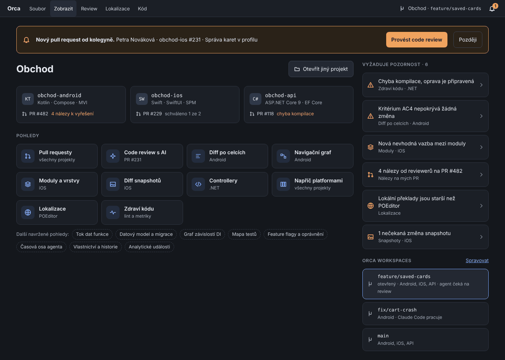

## 2. Hlavní menu

**Účel:** dostupnost všech pohledů a akcí z jednoho místa se zkratkami.

**Chování:**

| Nabídka | Položky |
| --- | --- |
| Soubor | Otevřít projekt, Workspaces a worktrees |
| Zobrazit | Přehled, Funkce napříč platformami, Navigační graf, Moduly a vrstvy, Controllery a akce, Diff snapshotů |
| Review | Pull requesty, Code review s AI, Nálezy na mých PR, Diff po celcích |
| Lokalizace | Klíče a překlady, Čekající změny a POEditor |
| Kód | Zdraví kódu a metriky |

- U položky omezené na jednu platformu je uveden její název.
- Vpravo aktuální projekt a větev (vede na správu workspaces) a zvonek s počtem nových PR.

**Oproti prototypu:** v Orce jde o nativní menu aplikace (`main/menu/register-app-menu.ts`), ne o lištu v okně. Projekt, větev a zvonek patří do titulkového pruhu nebo levého sidebaru.

**Stav implementace:**

- Položky pohledů jsou záznamy v registru `shared/app-menu-views.ts`; nový pohled přidá jeden záznam (nabídka, popisek, nápověda zkratky, cíl) a menu ani `register-app-menu.ts` se nemění. Nový druh cíle navíc přidá větev v `renderer/src/app-menu-views/open-app-menu-view.ts`.
- Nabídka Review má Pull requesty a Git graph. Nabídka Zobrazit má panely pravého sidebaru: Explorer, Search, Source Control, Checks, Ports, Agents, Backlog.md, Attached worktrees a PR Checks. Ostatní položky z tabulky přibudou se svými pohledy.
- Zkratka u položky je jen zobrazená nápověda z registru klávesových zkratek, ne akcelerátor menu: ten by klávesu zachytil v hlavním procesu dřív než renderer.
- Menu je pro všechny workspaces stejné. Panel, který aktuální workspace nemá (Git pohledy ve složce, Ports mimo SSH, panely folder workspace jinde), se neotevře a aplikace to oznámí. Z celostránkových pohledů (nastavení, úkoly) položka nejdřív vrátí zobrazení workspace.

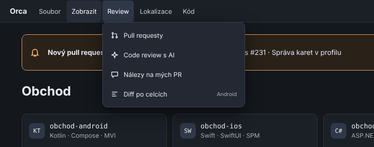

## 3. Otevření projektu

**Účel:** otevřít projekt jako celek všech platforem, ne jednotlivý repozitář.

**Chování:**

- Výběr složky projektu; repozitáře v ní se rozpoznají podle stacku.
- Uživatel zaškrtne platformy, které chce otevřít. Nepodporovaná platforma (např. TypeScript) se otevře jen se soubory a diffem.
- Výběr workspace s přehledem, ve kterých repozitářích worktree existuje, který vznikne při otevření, co dělá agent a jaké jsou PR.
- Shrnutí před otevřením („Otevře se obchod-android, obchod-ios, obchod-api ve workspace feature/saved-cards“).

**Oproti prototypu:** prototyp počítá se stejnou větví ve všech repozitářích. Platí model skupiny projektů s rolemi repozitářů a Funkcí, kde vlastní platforma má workspace a ostatní platformy jsou reference jen pro čtení (viz [Projekty a Funkce](./04-projekty-a-funkce.md)).

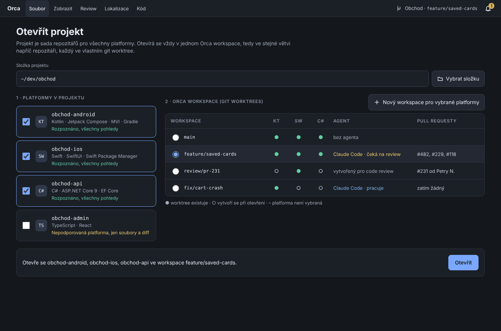

## 4. Pull requesty a oznámení

**Účel:** vidět všechny PR napříč repozitáři projektu a nepropásnout nový PR k review.

**Chování:**

- Skupiny Čeká na moje review, Moje pull requesty, Ostatní; filtr Všechny, Čeká na mě, Moje s počty.
- Řádek PR: platforma, číslo, název, repozitář, autor, zdrojová větev, stav kontrol (prošly, selhaly, běží), komentáře, stav review.
- Hlavní akce podle situace: Provést code review (nový PR), Pokračovat v review (rozpracované drafty), Odpovědět na nálezy (můj PR s nevyřešenými vlákny), Otevřít chybu (selhaný build).
- Nový PR, kde jsem reviewer, je označený a vyvolá oznámení s akcí Provést code review.

**Pravidla:** oznámení jen jednou za PR. Seznam je nezávislý na aktivním workspace. Navazuje na TASK-51 (seznam, filtry, nabídka AI review nových PR).

**Stav po TASK-63:**

- Čeká na moje review je otevřený PR, který není draft ani můj, jsem v něm reviewer jménem a ještě jsem nehlasoval. Moje jsou PR, které jsem založil, v jakémkoli stavu. Ostatní je zbytek, včetně PR, kde už jsem hlasoval.
- Rychlý filtr se kombinuje s filtry projektu, repozitáře, stavu a s hledáním; jeho počty platí pro aktuální výběr těchto filtrů.
- Řádek nabízí Provést review (čeká na mě, bez draftů) a Pokračovat v review (mám nepublikované drafty). Obě akce otevřou stránku PR; AI review se dál spouští z ní nebo z nabídky v aplikaci. Odpovědět na nálezy a Otevřít chybu přijdou v M2, stejně jako stav kontrol a počet komentářů na řádku.
- Značka Nový zůstává, dokud PR neotevřu. Nové PR hledá stávající pravidelná kontrola, bez dalších dotazů na Azure DevOps.
- Systémové oznámení přijde jednou za PR a po restartu se neopakuje. Řídí se nastavením oznámení včetně potlačení při aktivním okně; když u počítače nejsem, počká na návrat. Klik otevře PR. Na spárovaný telefon se neposílá.

**Stav po TASK-77:**

- Otevřené PR se čtou celé (po stránkách po 100, do stropu 1000 na repozitář), takže filtr stavu Vše ukáže každý otevřený PR, který ukazuje Aktivní. Vše se ptá dvakrát: na otevřené a na všechny.
- Uzavřené PR se čtou po jedné stránce. Když je stránka plná, seznam pod řádky řekne, kterých repozitářů se oříznutí týká, a nabídne Načíst starší; každé kliknutí přidá stránku, nejvýš 20 na repozitář. Hloubka se drží při obnově a vrací se na jednu stránku při změně filtru stavu.
- Když další stránka selže, zůstanou načtené stránky a seznam ukáže chybu i oříznutí.
- Protokol: nepovinný parametr `pages` metody `azureDevOpsReview.list` a nepovinné pole `truncatedRepoKeys` ve výsledku, které se posílá jen při oříznutí. Starší hostitel pole neposílá, proto klient další stránky nenabídne. `orca ado` oříznutí vypíše jako varování; mobilní klient ho zatím neukazuje.
- Úklid větví čte dokončené PR do cílové větve po 500 do stropu 5000; když další stránka selže, použije načtené.

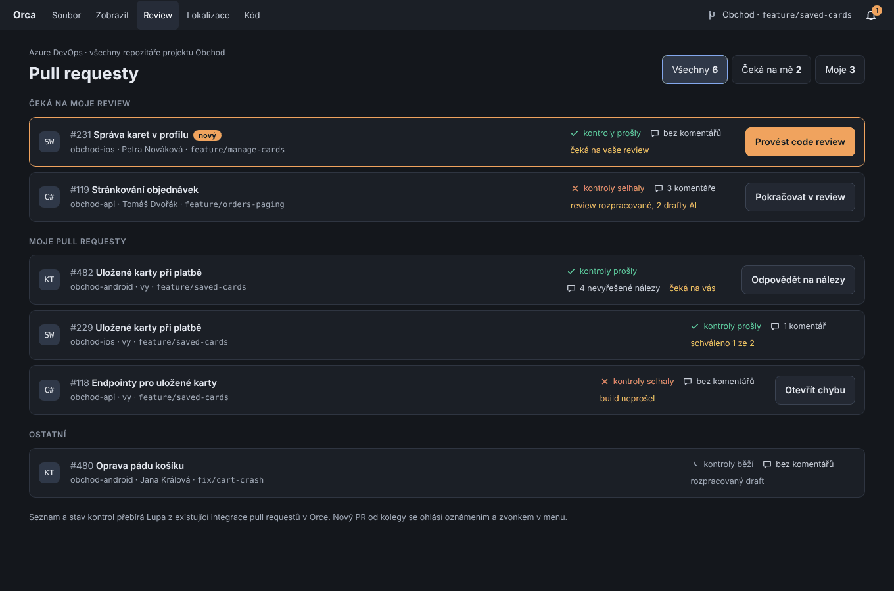

## 5. Code review s AI

**Účel:** review cizího PR v Orce se stejnými pohledy jako v Azure DevOps a s AI, která připraví drafty nálezů.

**Chování:**

- Hlavička: repozitář, číslo, autor, větve, stav kontrol, rozsah změn, revieweři; odkazy na review workspace a Diff po celcích.
- Záložky (čtyři podle [decision-12](../../backlog/decisions/decision-12%20-%20Odpov%C4%9Bdi-u%C5%BEivatele-z-2026-11-19-M2-v%C3%BDsledky-pokus%C5%AF-M3-Funkce-model-k%C3%B3du-a-dokon%C4%8Den%C3%AD-M1.md)); stránka se otevře na Drafts, když má PR nepublikované drafty, jinak na Overview:
  - **Overview:** popis PR v Markdownu, nebo zpráva, že popis chybí.
  - **Files** (počet změněných souborů): strom souborů s počtem draftů a diff po jednom souboru nebo všech změn v jednom posuvu. K řádku nebo k souboru jde napsat draft; vlákna a drafty jsou přímo v diffu a k draftu jde připojit pokyn pro AI.
  - **Threads** (počet vláken): všechna vlákna PR, aktivní napřed, se stavem, polohou nebo označením obecného komentáře a štítkem zastaralého vlákna. Tlačítko Reply vytvoří draft odpovědi.
  - **Drafts** (počet nepublikovaných): drafty uživatele i agenta, řazené podle priority nebo souboru a filtrovatelné (TASK-126), s tlačítky General comment, Ask AI a publikací vybraných draftů. Drafty od AI review agenta přibývají sem; souhrn AI stránka nemá.
- Když PR mění obrázky snapshot testů, přibude záložka Snapshots (viz oddíl 10, Diff snapshotů).
- Seznam změněných souborů s počtem nepublikovaných draftů u souboru, drafty agenta zvlášť; počítají se drafty k řádku a k souboru, odpovědi ve vláknech a obecné drafty ne. Hlavička stránky uvádí počet změněných souborů (TASK-125).
- Draft nálezu: závažnost (chyba, upozornění, návrh, drobnost), jistota u draftu od agenta (ověřeno, pravděpodobné, nejisté, rozporné), soubor a řádek, úryvek kódu, text a rozbalovací důkazy. Závažnost jde na kartě změnit. Akce:
  - **Publikovat** (zaškrtnutí) zařadí draft do publikace;
  - **Upravit ručně** přepne text na editovatelný;
  - **Zeptat se AI** položí otázku k nálezu a odpověď zobrazí pod ním;
  - **Zahodit** draft vyřadí.
- Spustit AI review znovu.
- Publikace: výběr hlasování (Hlas neměnit jako výchozí, Schválit, Schválit s připomínkami, Čekat na autora, Zamítnout) a odeslání vybraných draftů jedním krokem. Dialog předem vypíše, co odejde do Azure DevOps. Hlasovat jde i bez vybraných draftů.

**Pravidla:**

- Drafty vidí jen uživatel, dokud je nepublikuje.
- Publikuje vždy uživatel; agent drafty jen vytváří a upravuje (TASK-51).
- Nezaškrtnuté drafty zůstávají uložené lokálně.
- Hlas odchází až po draftech a jen když se odeslaly všechny. Když některý selže, dialog zůstane otevřený a řekne, co odešlo a co ne; hlas se nikam neukládá a při dalším pokusu ho uživatel volí znovu.
- Hlasuje jen uživatel v aplikaci po potvrzení dialogu. Hostitel hlas odmítne, když přijde přes lokální socket, kterým mluví `orca ado`, jeho MCP server a rozšíření pro Pi. Zrušit hlas (bez hlasu) jde jen v Azure DevOps.
- Hlas se nenabízí na vlastním, dokončeném a opuštěném pull requestu a proti hostiteli, který ho neumí odeslat (schopnost `azure-devops-review.vote.v1`). Pull request z forku hlasovat umí.
- AI review kontroluje změny proti zadání (pracovní položce) a pravidlům projektu.
- Jistotu nálezu odvozuje hostitel z důkazů, které agent přiložil, a agent ji poslat nemůže. Draft agenta bez důkazu je nejistý; s citací kódu, která na commitu draftu v souboru je, pravděpodobný; s citací, která tam není, rozporný. Důkaz s polohou v souboru změněném v pull requestu jde otevřít v diffu. Publikuje se jen text draftu. Změna závažnosti se nenabízí proti hostiteli, který ji neumí uložit (schopnost `azure-devops-review.findings.v1`). Viz TASK-84 a [AI a review](./06-ai-a-review.md), bod 7.
- Vlákno ukazuje na řádky poslední iterace. Azure DevOps vrací polohu z iterace, na které komentář vznikl, a jeho vlastní sledování posun často nevrátí; Orca proto porovná soubor v původní a v poslední iteraci. Posunutý kód vlákno následuje. Když byl komentovaný řádek přepsán, vlákno je označené jako zastaralé a stojí u řádku, který ho nahradil. Když řádek nebo soubor zanikl, je zastaralé vlákno jen v seznamech, s původním řádkem a iterací. Stejnou polohu vrací desktop, mobil, CLI i MCP.

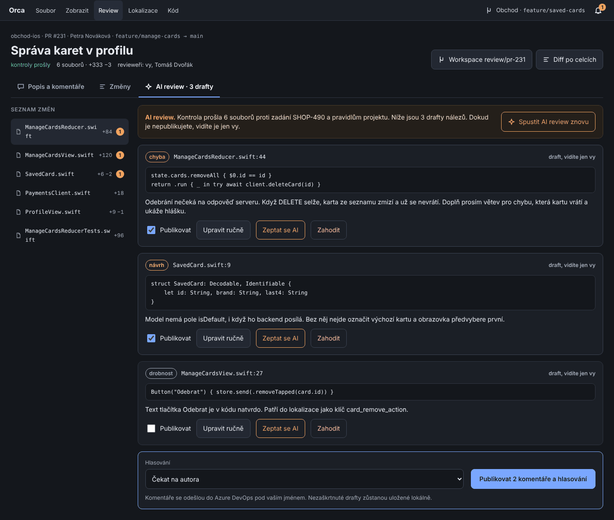

## 6. Nálezy na mých PR

**Účel:** rychle zpracovat připomínky reviewerů k vlastnímu PR.

**Chování:**

- Seznam vláken od reviewerů (včetně nálezů z jejich AI review) se souborem a řádkem.
- U každého vlákna návrh odpovědi od AI, který uživatel upraví.
- „Nechat agenta připravit změnu“ spustí agenta ve workspace PR; navržená změna se zobrazí jako diff a jde zahodit.
- „Commitnout, odpovědět a vyřešit“ jedním krokem; bez změny jen „Odpovědět a vyřešit“.
- Odkaz do souvisejícího pohledu (celek v diffu, lokalizace, obrazovka v grafu).
- Nadpis ukazuje počet vláken čekajících na odpověď.

**Pravidla:** změna od agenta je jen ve worktree, dokud ji uživatel nepotvrdí. Nic se neodešle bez potvrzení. Změna vzniká ve feature workspace, ne v review worktree.

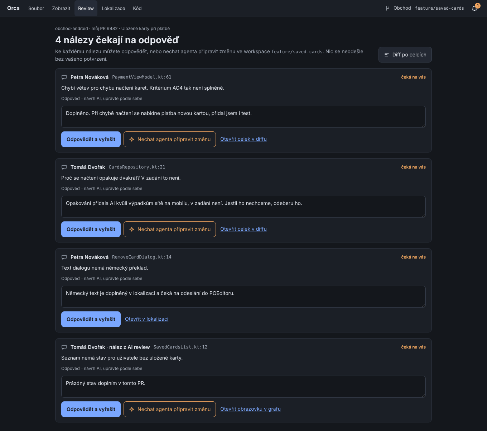

## 7. Diff po celcích a původ změn

**Účel:** zkrátit čas na pochopení velkého diffu, hlavně kódu od AI.

**Chování:**

- Souhrn AI k celému PR včetně počtu skrytých souborů.
- Diff rozdělený do tematických celků (např. stav a intenty, napojení na API, UI, testy). U celku počet souborů, změněných řádků a kritéria zadání, která pokrývá.
- Komentář AI ke každému celku: co se změnilo a proč, včetně rozhodnutí, která nejsou v zadání.
- Nepodstatné změny (importy, formátování, generovaný kód) jsou skryté; u souboru je počet skrytých řádků a přepínač je zobrazí.
- Původ každého přidaného řádku na okraji diffu:
  - **AC1, AC2…** řádek plyne z daného kritéria zadání;
  - **Vývojář** rozhodnutí vývojáře (např. upřesněné v promptu);
  - **AI** rozhodnutí AI mimo zadání.
- Panel zadání: kritéria s pokrytím; nepokryté kritérium je zvýrazněné jako mezera.
- Panel „Rozhodnutí mimo zadání“ s rozlišením AI a vývojáře.
- Celek lze označit jako zkontrolovaný; průběh je vidět v seznamu celků.

**Pravidla:** seskupení a komentáře se počítají na pozadí a ukládají podle commitu. Šum se rozpoznává deterministicky, ne přes AI. Původ řádků vychází ze zápisů agenta zachycených v hookách a z navázané pracovní položky.

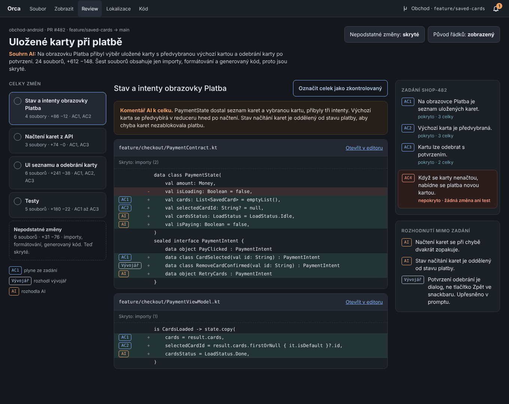

## 8. Navigační graf

**Účel:** vidět obrazovky aplikace, přechody mezi nimi a akce na obrazovkách, včetně změn z PR.

**Chování:**

- Rozpoznaná architektura (MVI: Screen, ViewModel, Contract; přechody z Compose Navigation).
- Karta obrazovky: název, třída obrazovky, intenty. Šipka u intentu značí přechod na jinou obrazovku nebo zpět.
- Náhled obrazovky nad kartou ze snapshot testů, jinak ze snímku emulátoru.
- Režim změn z PR: změněné obrazovky s počtem nových intentů, nové obrazovky a přechody; přepínač změny zobrazí nebo skryje.
- Panel vybrané obrazovky: soubory k otevření, stav s přidanými a odebranými poli, efekty, kód zpracování intentu se zvýrazněnými změnami.

**Pravidla:** vzory pro rozpoznání obrazovek, intentů a navigace jsou nastavitelné v projektu. Prvotní podpora je Android (MVI); stejný pohled pro iOS a jiné architektury bude potřeba doplnit.

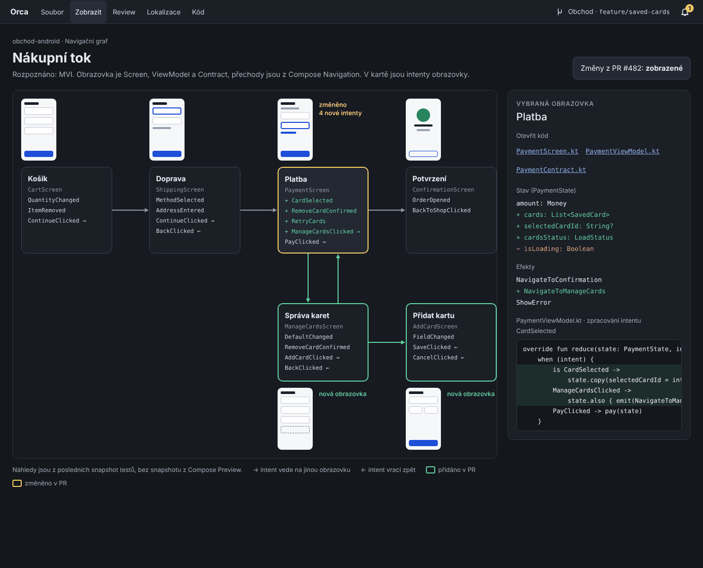

## 9. Moduly a vrstvy

**Účel:** odhalit nevhodné vazby mezi moduly a vrstvami, hlavně nové z PR.

**Chování:**

- Vrstvy (App, Features, Domain, Data, Core) s moduly; modul s porušením je zvýrazněný.
- Matice závislostí (řádek závisí na sloupci): povolená vazba, nová povolená vazba z PR, nevhodná vazba, nevhodná vazba nová v PR.
- Detail nové nevhodné vazby: soubor a importy, které ji způsobují, návrh opravy od AI, akce Připravit opravu a Otevřít import.
- Starší porušení zvlášť, aby nová byla vidět.

**Pravidla:** pravidla vrstev (např. Features → Domain a Core, Feature nezávisí na jiné Feature) jsou uložená v nastavení projektu v Orce a do repozitáře se nic neinstaluje.

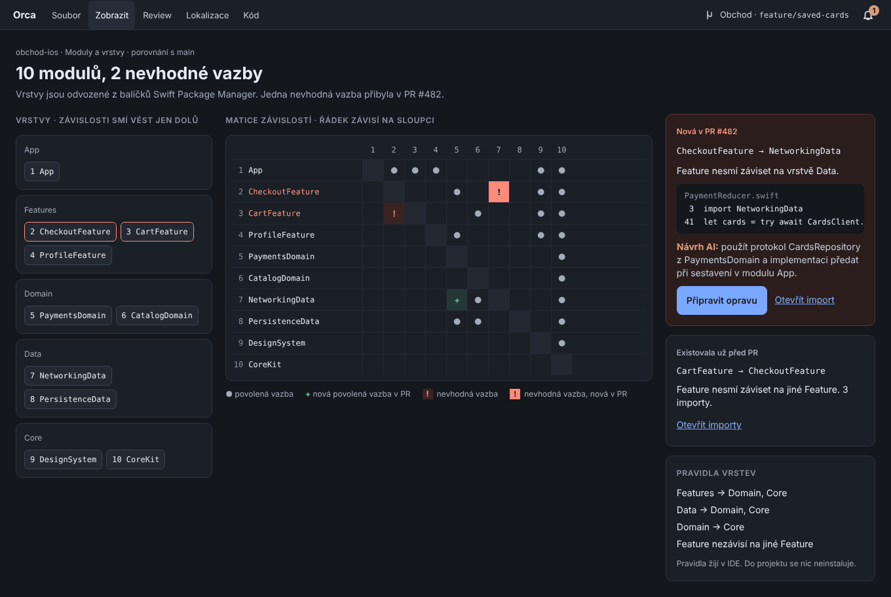

## 10. Diff snapshotů

**Účel:** rychle posoudit vizuální dopad změn a najít nečekané změny UI.

**Chování:**

- Seznam snapshotů se změnou, rozdělený na očekávané a nečekané; počet nezměněných.
- Pro vybraný snapshot: před, po a rozdíl s očíslovanými oblastmi změn; přepínač zvýraznění.
- U každé oblasti celek a soubor, které ji způsobily.
- Očekávaná změna: odkaz na kritéria zadání, akce Přijmout jako nový základ a Odmítnout.
- Nečekaná změna (obrazovka, které se PR netýká): příčina podle AI a řádek, který ji způsobil.

**Pravidla:** zdrojem jsou obrázky snapshot testů v repozitáři (Paparazzi, Roborazzi, swift-snapshot-testing). Změna je nečekaná, když ji nelze přiřadit žádnému celku PR.

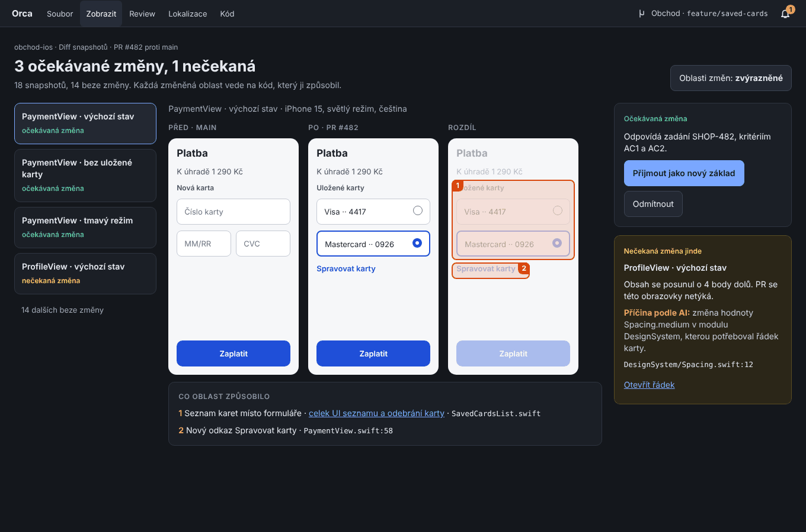

**Stav implementace (TASK-64, milník M1):**

- Hotovo: seznam změněných, přidaných a odebraných snapshotů; před, po a rozdíl; očíslované oblasti změn se skokem na oblast; přepínač zvýraznění.
- Pohled je režim záložky kombinovaného diffu (tlačítko Snapshots v její liště, View > Snapshots v hlavním menu), ne samostatná záložka. Funguje proto ve všech režimech kombinovaného diffu: větev proti základu, všechny změny, necommitnuté změny i jeden commit. Na stránce pull requestu Azure DevOps je to záložka Snapshots; stránka pull requestu GitHubu a GitLabu obsah obrázků nevrací, takže tam pohled zatím není.
- Snapshot se pozná jen podle cesty, vzory jsou v `src/shared/snapshot-image-path.ts`: Paparazzi `src/<sourceSet>/snapshots/images/`, swift-snapshot-testing `__Snapshots__/`, Roborazzi adresář `roborazzi/` nebo `src/[<sourceSet>/]screenshots/` (výstupy `_actual` a `_compare` se nepočítají). Projekt s vlastní výstupní cestou Roborazzi se nepozná, dokud nepřibude nastavení.
- Rozdíl se počítá ve workeru. Nad 8 megapixelů (plátno, které pokryje oba obrázky) se nepočítá a pohled to řekne; před a po se zobrazí dál.
- Oblast je souvislá skupina změněných pixelů v mřížce 8 px; nad 24 oblastí se sousední slučují.
- Odloženo do M2 (potřebuje Diff po celcích): dělení na očekávané a nečekané, počet nezměněných, celek a soubor u oblasti, příčina podle AI, Přijmout jako nový základ a Odmítnout.

## 11. Controllery a akce

**Účel:** přehled API backendu a jeho změn v kontextu klientů, kteří ho volají.

**Chování:**

- Controllery s cestou a autorizací; akce s metodou, cestou, signaturou, kódy odpovědí, klienty a změnou v PR (nová, změněná).
- Filtr jen změněných akcí.
- Klient „jen Android“ nebo „nikdo“ je zvýrazněný jako možná mezera.
- Detail akce: cesta požadavku (autorizace, validace, handler, služby, tabulky), diff kontraktu s komentářem AI ke zpětné kompatibilitě, volající klienti s odkazem do jejich kódu, nálezy (např. chybějící test, chybějící volání na platformě).

**Pravidla:** klienti se párují podle volaných endpointů v kódu mobilních aplikací.

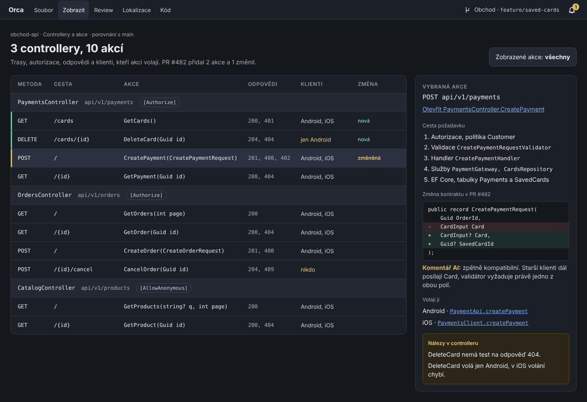

## 12. Funkce napříč platformami

**Účel:** porovnat implementaci jedné funkce na všech platformách a najít rozdíly.

**Chování:**

- Řádky podle částí funkce: obrazovka, stav, akce uživatele, načtení dat, odebrání, platba, model, texty, testy.
- Sloupce Android, iOS, Backend; buňka obsahuje symbol v kódu (odkaz) a popis. Část, které se platforma netýká, je označená.
- Chybějící nebo odlišná implementace je zvýrazněná (chyba, upozornění).
- Filtr jen řádků s rozdílem.
- Detail rozdílu s dopadem na zadání a akcí „Připravit změnu pro iOS podle Androidu“.

**Pravidla:** části se párují podle endpointů, názvů modelů a lokalizačních klíčů. Chybné spárování jde ručně opravit a Orca si opravu pamatuje.

**Oproti prototypu:** sloupce ostatních platforem jsou reference Funkce; u každé je uveden odkaz (větev, PR, mergnuto) a commit. Akce přípravy změny na cizí platformě je návrh pro kolegu, ne změna v jeho repozitáři.

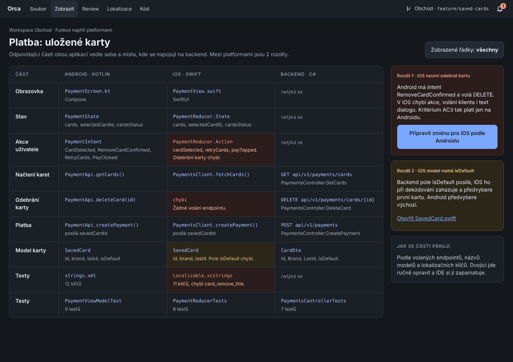

## 13. Lokalizace

**Účel:** spravovat texty všech platforem v jedné tabulce, jako ResXManager.

**Chování:**

- Tabulka klíčů nad `strings.xml` (Android), `Localizable.xcstrings` (iOS) a `Resources.resx` (.NET): klíč, platformy, kde je použitý, sloupec na jazyk, stav.
- Filtry: všechny klíče, chybí překlad, jiné zástupné znaky než výchozí jazyk, chybí na některé platformě, nepoužité v kódu, změněné v PR. U filtru počet.
- Chybějící překlad a nesoulad zástupných znaků jsou v buňce zvýrazněné.
- Přidání klíče: klíč a výchozí text; zápis do souborů platforem; ostatní jazyky navrhne AI nebo doplní překladatelé.
- Úprava buňky s místem použití v kódu a návrhem AI, který zachová zástupné znaky a délku vhodnou pro UI.
- Upozornění, že lokální kopie je starší než POEditor, s odkazem na synchronizaci.
- Počítadlo čekajících změn.

**Pravidla:** každé přidání, úprava nebo smazání se zapíše do souborů a zároveň zařadí mezi čekající změny pro POEditor. Nic se neodesílá automaticky.

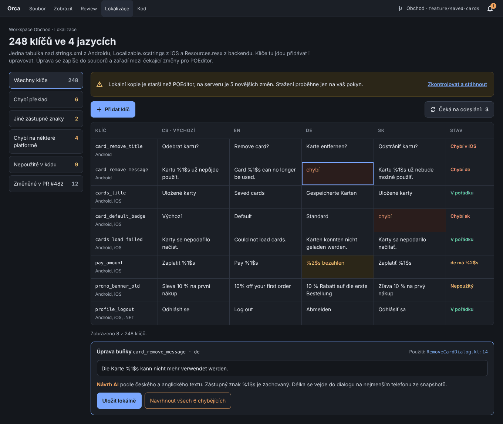

## 14. Synchronizace s POEditorem

**Účel:** kontrolovaně odesílat a stahovat překlady.

**Chování:**

- Stav serveru: lokální kopie je zastaralá (počet novějších změn, datum posledního stažení) s doporučením stáhnout, nebo aktuální.
- Stringy navíc: klíče v souborech, které nejsou na serveru ani mezi čekajícími změnami; akce Přidat mezi čekající nebo Odebrat lokálně.
- Seznam čekajících změn: typ (upraveno, nový klíč, smazáno), klíč, jazyky a platformy, původní a nová hodnota, varování (chybějící jazyky, změna stejného textu na serveru). U každé výběr k odeslání a Vrátit změnu.
- Po stažení se konflikt se čekající změnou označí a vyřeší v tabulce.
- Odeslání vybraných změn jedním krokem.

**Pravidla:** stažení ze serveru i odeslání na server jen na pokyn uživatele. Odeslání mění jen server, soubory v repozitáři zůstávají. Token k POEditoru je uložený šifrovaně.

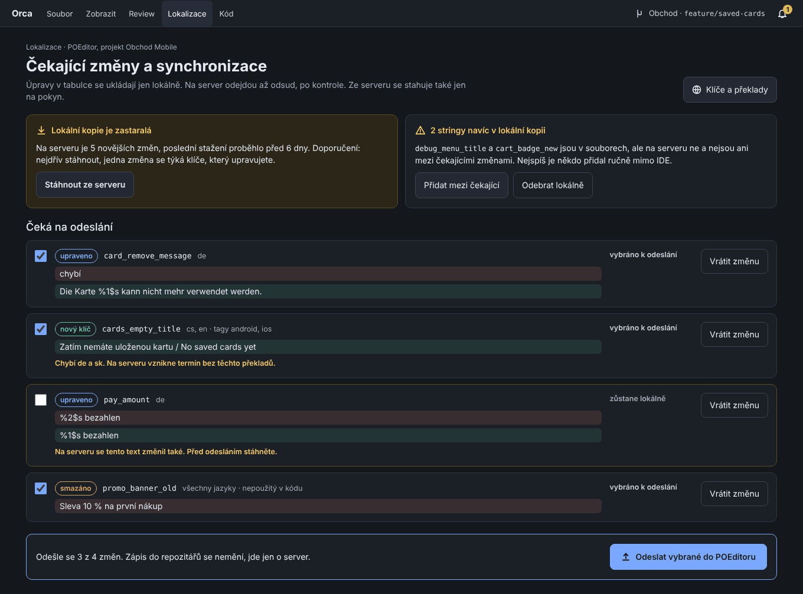

## 15. Zdraví kódu a metriky

**Účel:** hlídat kvalitu kódu i bez nastaveného lintu a opravovat nálezy jedním krokem.

**Chování:**

- Zdroje kontrol pro každý repozitář: lint, který projekt už má (detekt, ktlint, SwiftLint), nebo informace, že lint chybí; vlastní kontroly IDE a metriky; návrh, co přidat do codebase (pravidla do konfigurace, integrace lintu jako PR).
- Nálezy s připravenou opravou, rozlišené podle zdroje: chyba kompilace, kontrola IDE, lint projektu. U nálezu pravidlo, místo, popis a diff opravy.
- Použít opravu u jednoho nálezu, nebo Použít opravy podle pravidel hromadně (jen deterministické opravy lintu).
- Vlastní kontrolu IDE lze přidat jako pravidlo do konfigurace lintu projektu.
- Metriky souborů: řádky, cyklomatická složitost, počet změn za 90 dní, pokrytí testy; řazení podle sloupce, hodnoty za limitem zvýrazněné.

**Pravidla:** výchozí limity jsou 400 řádků na soubor, složitost 15 a pokrytí 50 %, nastavitelné v projektu. Opravu navrženou AI je potřeba zkontrolovat a je tak označená. Hromadná oprava nepoužije opravy od AI.

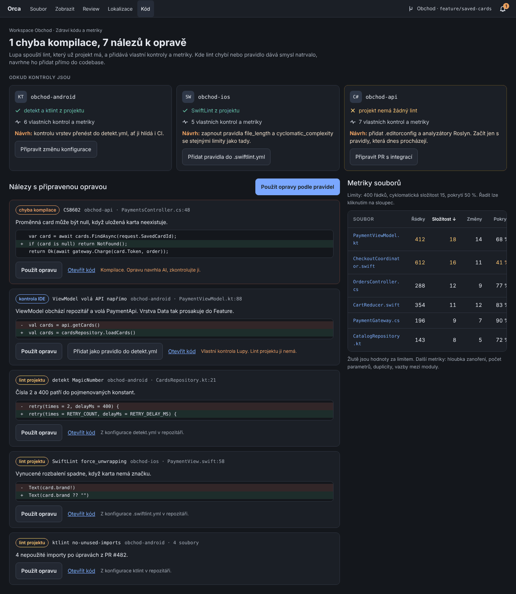

## 16. Společné chování

- Každý pohled umí otevřít kód vybrané části v editoru Orky nebo v externím IDE na konkrétním řádku.
- Grafické pohledy (navigační graf, moduly, controllery, napříč platformami) umí zobrazit změny proti bázi PR.
- AI výstupy (komentáře, drafty, návrhy oprav a překladů) jsou vždy označené a nic neodchází ven bez potvrzení uživatele.
- Agent pracuje jen ve worktree; publikace do Azure DevOps a POEditoru je vždy akce uživatele.
